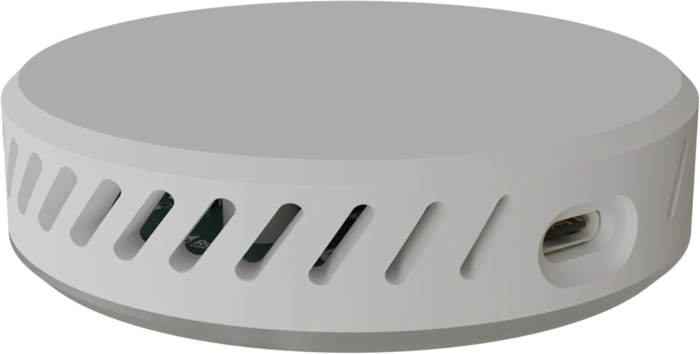
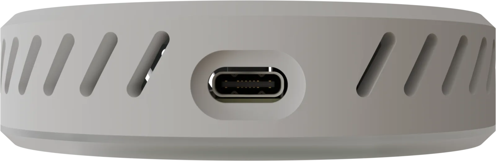
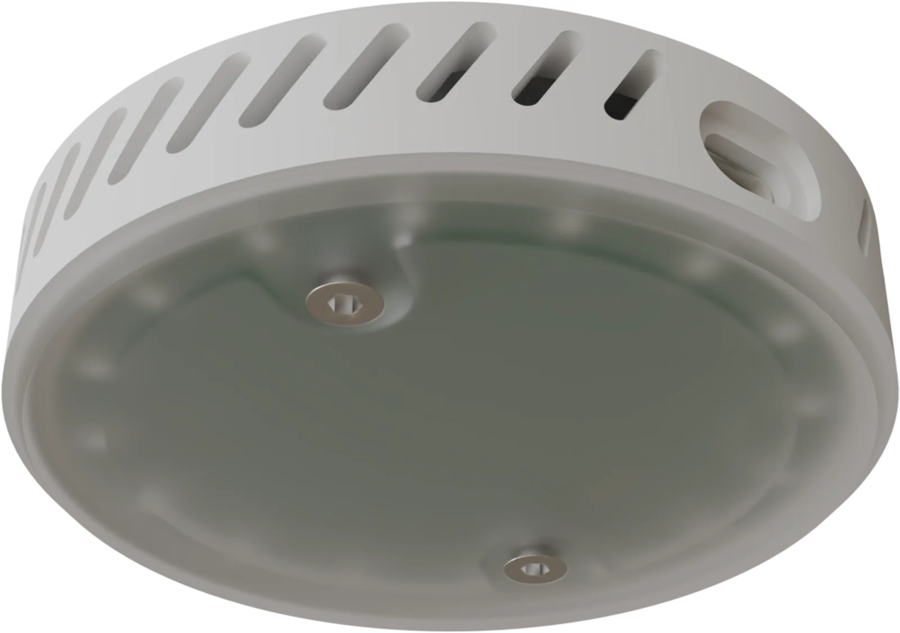
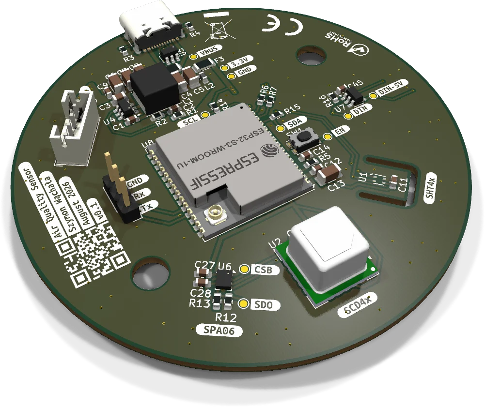
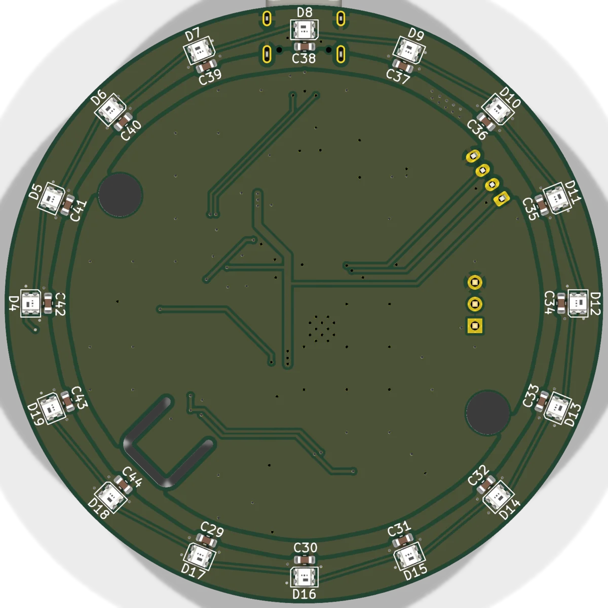

<div align="center">

# Air Quality Sensor

**A compact, open-hardware indoor air quality monitor built around the ESP32-S3.**
Measures CO₂, temperature, humidity and pressure, and shows the room's air quality on a ring of RGB LEDs.




[](LICENSE)

</div>

---

## Features

- **True CO₂ measurement.** Sensirion **SCD41** photoacoustic NDIR sensor, not an estimated eCO₂ value.
- **Temperature & humidity.** Sensirion **SHT4x**, placed on a thermally isolated PCB island (milled slot) to keep it away from heat from the MCU and regulator.
- **Barometric pressure.** Goertek **SPA06-003**.
- **Wi-Fi + Bluetooth LE.** **ESP32-S3-WROOM-1U** with an external antenna connector (U.FL).
- **16× WS2812 LED ring** on the bottom side, shining through a translucent diffuser. The 5 V data line goes through a 74AHCT1G125 level shifter.
- **USB-C power** with ESD protection (USBLC6-2) and fuses, plus a TPS54302 buck regulator for the 3.3 V rail.
- **Expansion port.** JST-PH 4-pin connector with 3.3 V, GND and two free GPIOs.
- **Debug UART header** and test points on every important net.
- **Round Ø70 mm PCB** in a 3D-printable enclosure with angled ventilation slots.

## Gallery

<table>
  <tr>
    <td align="center"><br><sub>USB-C side</sub></td>
    <td align="center"><br><sub>Bottom with LED diffuser</sub></td>
  </tr>
</table>

### PCB

<table>
  <tr>
    <td align="center" width="50%"><br><sub>Top side</sub></td>
    <td align="center" width="50%"><br><sub>Bottom side – LED ring</sub></td>
  </tr>
</table>

📄 **[Schematic (PDF)](docs/schematic.pdf)**

## Hardware overview

| Block | Part | Notes |
|---|---|---|
| MCU | ESP32-S3-WROOM-1U | Wi-Fi 4 / BLE 5, external antenna |
| CO₂ | Sensirion SCD41 | 400–5000 ppm, I²C |
| Temperature / RH | Sensirion SHT4x | I²C, thermally isolated |
| Pressure | Goertek SPA06-003 | I²C |
| Indicator | 16× WS2812C-2020 | Driven through 74AHCT1G125 level shifter |
| Power | USB-C → TPS54302 buck → 3.3 V | USBLC6-2 ESD protection, PTC fuses |
| PCB | Ø70 mm, round | Designed for JLCPCB assembly (LCSC part numbers in BOM) |

```
 USB-C ──► ESD + fuse ──► TPS54302 ──► 3.3 V ─┬─► ESP32-S3 ──I²C──┬─► SCD41  (CO₂)
   │                                          │       │           ├─► SHT4x  (T / RH)
   └──────────── 5 V ─────────────────────────┼───────┼──────┐    └─► SPA06  (pressure)
                                              │       │      ▼
                                              │       └──► 74AHCT1G125 ──► 16× WS2812 ring
                                              └─► JST-PH expansion (2× GPIO)
```

## Repository structure

```
.
├── 01_Hardware/
│   ├── 02_KiCad/
│   │   ├── air-quality-sensor/    # KiCad project (schematic + PCB)
│   │   │   └── production/        # Gerbers, BOM, pick & place (JLCPCB)
│   │   └── lib/                   # Custom symbols, footprints, 3D models
│   └── 03_3D_Model/
│       ├── 3D-Printing/           # Enclosure STL / 3MF files
│       └── test.blend             # Blender scene used for the renders
├── 02_Software/                   # Firmware (coming soon)
└── docs/                          # Images and schematic PDF for this README
```

## Roadmap

- [x] Schematic
- [x] PCB layout v0.1 (Ø70 mm)
- [x] Enclosure design & renders
- [ ] Order and assemble the first prototype
- [ ] Hardware bring-up & validation
- [ ] Firmware: sensor readout, LED air-quality indication
- [ ] Home Assistant integration (ESPHome / MQTT)
- [ ] Hardware v1.0 release

## Building one

> [!WARNING]
> This project is **work in progress**. Hardware v0.1 has not been manufactured and tested yet, so order boards at your own risk.

1. Open `01_Hardware/02_KiCad/air-quality-sensor/air-quality-sensor.kicad_pro` in **KiCad 10**.
2. The fabrication files (Gerbers, BOM, CPL) for JLCPCB are in `production/`.
3. Print the enclosure from `01_Hardware/03_3D_Model/3D-Printing/`.

## License

**Hardware** (schematics, PCB, enclosure, renders): [**CC BY-NC-SA 4.0**](LICENSE).
You may build, study and modify this design for **non-commercial** purposes, as long as you credit the author and share your changes under the same license.
**Selling boards, kits or devices based on this design is not allowed** without the author's written permission.

**Firmware** (`02_Software/`): [**GPL-3.0**](02_Software/LICENSE).

For commercial licensing, please get in touch.

---

<div align="center">
<sub>Designed by <b>Szymon Wąchała</b> · 2026</sub>
</div>
